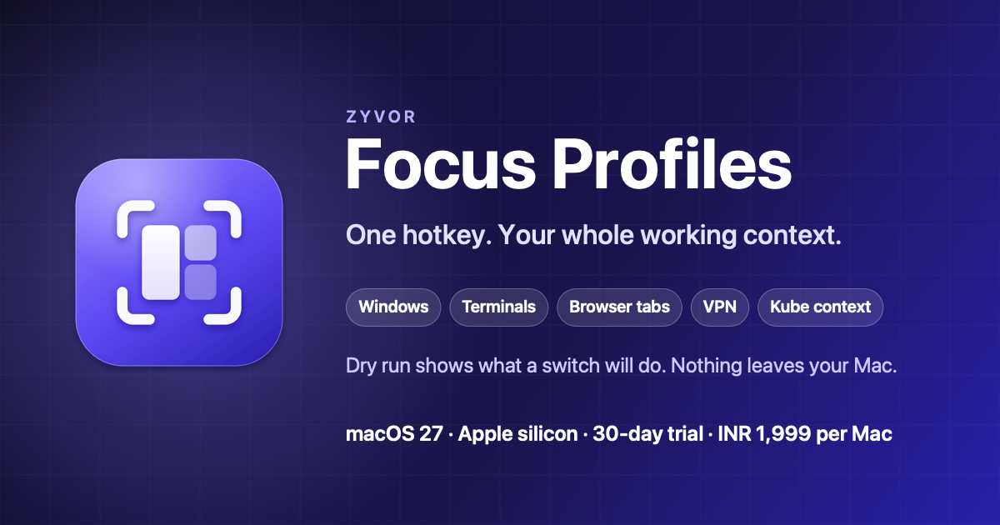

# Focus Profiles

### One hotkey. Your whole working context.

Switch a per-project profile with one hotkey: your window layout, terminal windows, browser tabs, VPN and kube context. A dry run shows what it would do before it does anything. Native macOS 27 menu-bar app.

 

**[Ask for a 30-day trial](mailto:sales@zyvor.dev?subject=Focus%20Profiles%20trial%20key)** &nbsp;·&nbsp; [Website](https://zyvorai.github.io/focus/) &nbsp;·&nbsp; [Docs](docs/INSTALL.md) &nbsp;·&nbsp; [Buy](https://zyvor.dev/buy#focus-profiles)

macOS 27 or later · Apple silicon · Developer ID signed and notarized

---

## Get it

| | |
| --- | --- |
| **Trial** | A free 30-day trial key: **sales@zyvor.dev**. You do not need a key to use the app. |
| **Download** | No public download is posted yet. Write to sales@zyvor.dev and we send the notarized DMG with your trial key. Downloads will be attached to this repository's [releases](releases) when the first one is published. |
| **Requirements** | macOS 27 or later, Apple silicon |
| **Pricing** | INR 1,999 per Mac, one-time, incl. 18% GST in India and one year of updates (about US$20 excl. tax outside India). Teams of 5 or more Macs: INR 1,699 per Mac (about US$17 excl. tax), minimum 5 Macs (INR 8,495, about US$86), by invoice. Prices: INR incl. 18% GST in India; US dollars excl. tax elsewhere (VAT, GST or sales tax added where applicable). Standard orders: pay online with Razorpay (UPI, card, netbanking). Bigger orders, team and volume orders, and customers outside India: we send a US-dollar invoice and you pay through Skydo (international bank transfer, or card/ACH through a secure Skydo link). Custom pricing: contact sales@zyvor.dev. Buy: [zyvor.dev/buy](https://zyvor.dev/buy#focus-profiles) (30-day trial first). |

## What it does

One profile per project. One hotkey per profile. Each profile can:

- **Place windows** where you want them (the Accessibility API; no private Spaces API). Positions are fractions of the main display's usable area.
- **Open terminal windows** in a folder and run a command, in Terminal or iTerm2.
- **Open browser tabs** in Safari or Google Chrome (http and https only).
- **Connect or disconnect a VPN** from System Settings (`scutil --nc`).
- **Switch the kube context** (`kubectl config use-context`).

**Dry run first.** `FocusProfiles --dry-run` (and the Dry Run button in the editor) prints exactly what a switch would do, including what would be skipped for missing permissions. It moves nothing, launches nothing and prompts for nothing.

**Permissions only when needed.** macOS is asked for Accessibility when you first switch a profile that places windows, and for Automation per app (Terminal, iTerm2, Safari, Chrome) the first time a profile uses it. If you say no, those steps are skipped and listed, and the rest of the profile still runs.

**Plain files.** Profiles are JSON, one file per profile, in `~/Library/Application Support/Focus Profiles/Profiles/`. Edit them in the app or by hand.

## Privacy and security

- **No network.** Focus Profiles contains no networking code, and its only entitlement is Automation (`com.apple.security.automation.apple-events`). Verify: `codesign -d --entitlements - "/Applications/Focus Profiles.app"`. It is not sandboxed.
- It does not read window contents, record the screen, watch keystrokes, or read your browser tabs or terminal output.
- A terminal command in a profile is typed into a new terminal window exactly as written, so only keep commands you trust.

See [docs/PRIVACY.md](docs/PRIVACY.md).

## Limits

- Early release: beyond its automated self-tests, the interactive click-through, the Accessibility and Automation prompts, VoiceOver and a clean-Mac install have not been tested by us.
- Window placement is as good as the target app allows: an app that refuses to be resized or has no window is skipped and reported.

## Trial and licence

30-day trial key: sales@zyvor.dev. Without a key, or after a trial, no data is lost and the app keeps working; a commercial license is required for production use. INR 1,999 per Mac, one-time, incl. 18% GST in India and one year of updates (about US$20 excl. tax outside India). Teams of 5 or more Macs: INR 1,699 per Mac (about US$17 excl. tax), minimum 5 Macs (INR 8,495, about US$86), by invoice. Prices: INR incl. 18% GST in India; US dollars excl. tax elsewhere (VAT, GST or sales tax added where applicable). Standard orders: pay online with Razorpay (UPI, card, netbanking). Bigger orders, team and volume orders, and customers outside India: we send a US-dollar invoice and you pay through Skydo (international bank transfer, or card/ACH through a secure Skydo link). Custom pricing: contact sales@zyvor.dev. Buy: [zyvor.dev/buy](https://zyvor.dev/buy#focus-profiles). Licensed under the [Zyvor Production Licence v2.0](LICENSE); see [NOTICE](NOTICE) and [docs/LICENSING.md](docs/LICENSING.md).

**The Focus Profiles source code is private.** This repository holds documentation and the website.

Copyright © 2026 Zyvor AI Labs Private Limited · [zyvor.dev](https://zyvor.dev)
